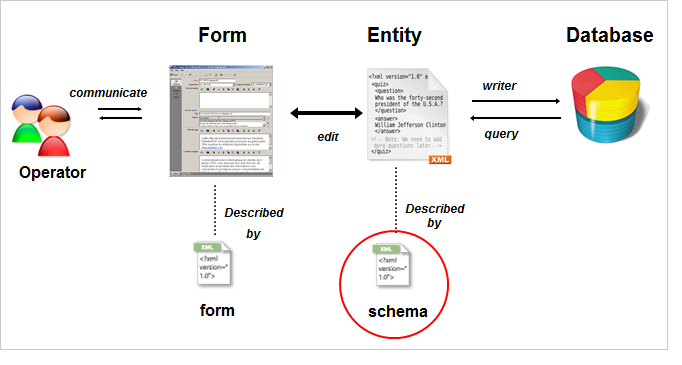

# スキーマの基本を学ぶ {#about-schema-reference}

## スキーマとは {#what-is-a-schema}

この章では、Adobe Campaign データベースの概念データモデルを拡張するために、拡張スキーマを設定する方法について説明します。

Campaignの組み込みテーブルとそのインタラクションについて詳しくは、[Campaign Classic データモデル &#x200B;](https://experienceleague.adobe.com/ja/docs/campaign/campaign-v8/developer/datamodel){target="_blank"} （Campaign v8 ドキュメント）を参照してください。

Adobe Campaignでは、アプリケーションに格納されるデータの物理構造と論理構造をXMLで記述します。 **スキーマ**&#x200B;は、データベーステーブルに関連付けられたXML ドキュメントです。 この中でデータ構造を定義し、表の SQL 定義を記述します。

* テーブルの名前
* フィールド
* 索引
* 他のテーブルとのリンク

また、データの格納に使用する XML 構造についても説明します。

* 要素と属性
* 要素の階層
* 要素と属性の種類
* デフォルト値
* ラベル、説明およびその他のプロパティ。

スキーマを使用すると、データベース内にエンティティを定義できます。 エンティティごとにスキーマがあります。

次の図は、Adobe Campaign データシステム内のスキーマの場所を示しています。

Campaign v7 から v8 への移行の一環として、Campaign Classic のドキュメントセットを効率化および再編成しました。 共通機能は、Campaign v8 ドキュメントセットでのみ使用できるようになりました。 スキーマの構文と識別について詳しくは、[Campaign v8 ドキュメント &#x200B;](https://experienceleague.adobe.com/en/docs/campaign/campaign-v8/developer/schemas-forms/schemas){target=_blank}を参照してください。

{target=_blank}
