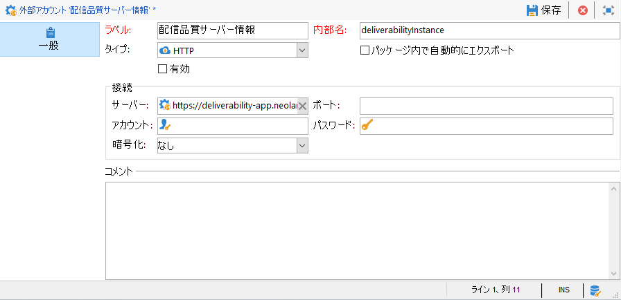

# インボックスレンダリング{#inbox-rendering}

Adobe Campaignは、[Litmus](https://litmus.com/email-testing) web ベースの電子メールテストソリューションを活用して、電子メールのレンダリングをキャプチャし、専用のレポートで利用できるようにします。

>[!NOTE]
>
>Campaign v7 から v8 への移行の一環として、Campaign Classic のドキュメントセットを効率化および再編成しました。 共通機能は、Campaign v8 ドキュメントセットでのみ使用できるようになりました。 受信トレイのレンダリングについて詳しくは、[Campaign v8 ドキュメント ](https://experienceleague.adobe.com/en/docs/campaign/campaign-v8/send/deliverability-management/inbox-rendering){target=_blank}を参照してください。
>
>[](https://experienceleague.adobe.com/en/docs/campaign/campaign-v8/send/deliverability-management/inbox-rendering){target=_blank}

## 受信ボックスレンダリングの有効化 {#activating-inbox-rendering}

[!BADGE オンプレミスおよびハイブリッド]{type=Caution url="https://experienceleague.adobe.com/docs/campaign-classic/using/installing-campaign-classic/architecture-and-hosting-models/hosting-models-lp/hosting-models.html?lang=ja" tooltip="オンプレミスデプロイメントとハイブリッドデプロイメントにのみ適用されます"}

ホストクライアントおよびハイブリッドクライアントの場合、受信ボックスレンダリングはアドビのテクニカルサポートおよびコンサルタントがインスタンスに設定します。 詳しくは、アドビのアカウント担当者にお問い合わせください。

オンプレミスインストールの場合は、次の手順に従って受信ボックスレンダリングを設定します。

1. **[!UICONTROL 受信ボックスレンダリング（IR）]**&#x200B;パッケージをインストールするには、**[!UICONTROL ツール]**／**[!UICONTROL 詳細設定]**／**[!UICONTROL パッケージをインポート]**&#x200B;メニューを使用します。 詳しくは、[Campaign Classic 標準パッケージのインストール](../../installation/using/installing-campaign-standard-packages.md)を参照してください。
1. HTTP タイプの外部アカウントは、**[!UICONTROL 管理]**／**[!UICONTROL プラットフォーム]**／**[!UICONTROL 外部アカウント]**&#x200B;ノードで設定します。 詳しくは、[外部アカウントの作成](../../installation/using/external-accounts.md#creating-an-external-account)を参照してください 。
1. 外部アカウントのパラメーターを次のように設定します。
   * **[!UICONTROL ラベル]**：配信品質サーバー情報
   * **[!UICONTROL 内部名]**： deliverabilityInstance
   * **[!UICONTROL タイプ]**： HTTP
   * **[!UICONTROL サーバー]**： https://deliverability-app.neolane.net/deliverability
   * **[!UICONTROL 暗号化]**：なし
   * 「**[!UICONTROL 有効]**」オプションをオンにします。

   

1. **[!UICONTROL 管理]**／**[!UICONTROL プラットフォーム]**／**[!UICONTROL オプション]**&#x200B;ノードに移動します。 「**[!UICONTROL DmRendering_cuid]**」オプションを検索します。サポートに連絡して、**[!UICONTROL 値 (テキスト)]** フィールドにコピーする必要のある、配信レポートの識別子を取得します。
1. **serverConf.xml** ファイルを編集して、Litmus サーバーへの呼び出しを許可します。 次の行を `<urlPermission>` セクションに追加します。

   ```
   <url dnsSuffix="deliverability-app.neolane.net" urlRegEx="https://.*"/>
   ```

1. 次のコマンドを使用して、設定を再読み込みします。

   ```
   nlserver config -reload
   ```

>[!NOTE]
>
>受信ボックスレンダリングを使用するには、コンソールからログアウトし、再度ログインする必要がある場合があります。
