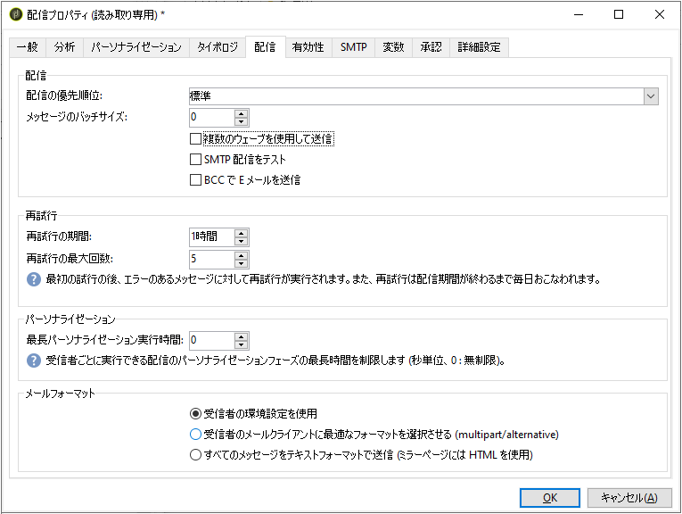
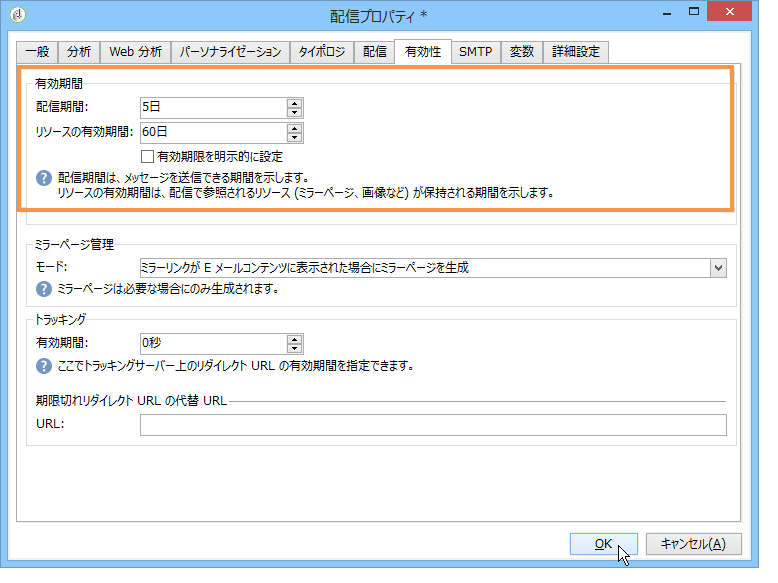

# 配信の設定と送信 {#configuring-and-sending-the-delivery}

ここでは、Campaign Classic v7のオンプレミスおよびハイブリッドインストールに固有の配信送信設定について説明します。

Campaign v7 から v8 への移行の一環として、Campaign Classic のドキュメントセットを効率化および再編成しました。 共通機能は、Campaign v8 ドキュメントセットでのみ使用できるようになりました。 配信の送信設定について詳しくは、[Campaign v8 ドキュメント &#x200B;](https://experienceleague.adobe.com/en/docs/campaign/campaign-v8/send/validate/configure-and-send){target=_blank}を参照してください。

{target=_blank}

## 配信の追加パラメーター {#delivery-additiona-parameters}

配信を送信する前に、配信プロパティの「**[!UICONTROL 配信]**」タブで送信パラメーターを定義できます。

* **[!UICONTROL SMTP 配信をテスト]**：SMTP 経由での送信をテストします。 配信は SMTP サーバーに接続するまで処理されますが、送信はされません。配信のすべての受信者について、Campaign は SMTP プロバイダーサーバーに接続し、「SMTP RCPT TO」コマンドを実行して、「SMTP DATA」コマンドの前に接続を閉じます。

  >[!NOTE]
  >
  >* このオプションは、ミッドソーシングで設定しないでください。
  >
  >* SMTP サーバー設定の詳細については、[この節](../../installation/using/configure-delivery-settings.md)を参照してください。

## 再試行の設定 {#configuring-retries}

>[!IMPORTANT]
>
>ホストインストールまたはハイブリッドインストールで、[Enhanced MTA](sending-with-enhanced-mta.md) にアップグレードした場合、Campaign では配信の再試行設定が使用されなくなります。 ソフトバウンスの再試行とその間隔は、メッセージの電子メールドメインから返されるバウンス応答のタイプと重大度に基づいて、Enhanced MTA が決定します。

従来の Campaign MTA を使用したオンプレミスインストールおよびホスト／ハイブリッドインストールの場合、配信パラメーターの「**[!UICONTROL 配信]**」タブの中央セクションは、配信の翌日に実行する再試行の数と再試行間の最小遅延を示します。

デフォルトでは、配信後の最初の日に最低 1 時間の間隔をおいて、24 時間に 5 回の再試行がスケジュールされます。 その後は、「**[!UICONTROL 有効性]**」タブで指定される配信期限が来るまで、1 日 1 回の再試行がスケジュールされます。 詳しくは、[有効期間を定義](#defining-validity-period)を参照してください。

## 有効期間を定義 {#defining-validity-period}

メッセージの送信（および再試行）が可能な期間は、配信が開始されたときから配信期限までです。 配信期限は、配信プロパティの「**[!UICONTROL 有効性]**」タブに表示されます。

* 「**[!UICONTROL 配信期間]**」フィールドには、グローバルでおこなう配信再試行の期限を入力できます。 Adobe Campaign は、開始日にメッセージの送信を開始した後、エラーのみを返すメッセージについて、設定された定期的な再試行を、有効期限日に達するまで実行します。

  >[!IMPORTANT]
  >
  >ホストインストールまたはハイブリッドインストールで、[Enhanced MTA](sending-with-enhanced-mta.md) にアップグレードした場合、Campaign のメール配信の&#x200B;**[!UICONTROL 配信期間]**&#x200B;設定は、**3.5 日以下**&#x200B;に設定された場合にのみ使用されます。 3.5 日を超える値を定義した場合、その値は考慮されません。

* **リソースの有効期限**：「**[!UICONTROL 有効期限]**」フィールドは、アップロードされたリソース（主にミラーページと画像）に関して使用されます。 ディスクスペースを節約するために、このページ上のリソースが有効な期間は限られています。

  このフィールドの値は、**s**（秒）、**m**（分）、**h**（時間）、**d**（日）（デフォルト）、**y**（年）の単位で表すことができます。
