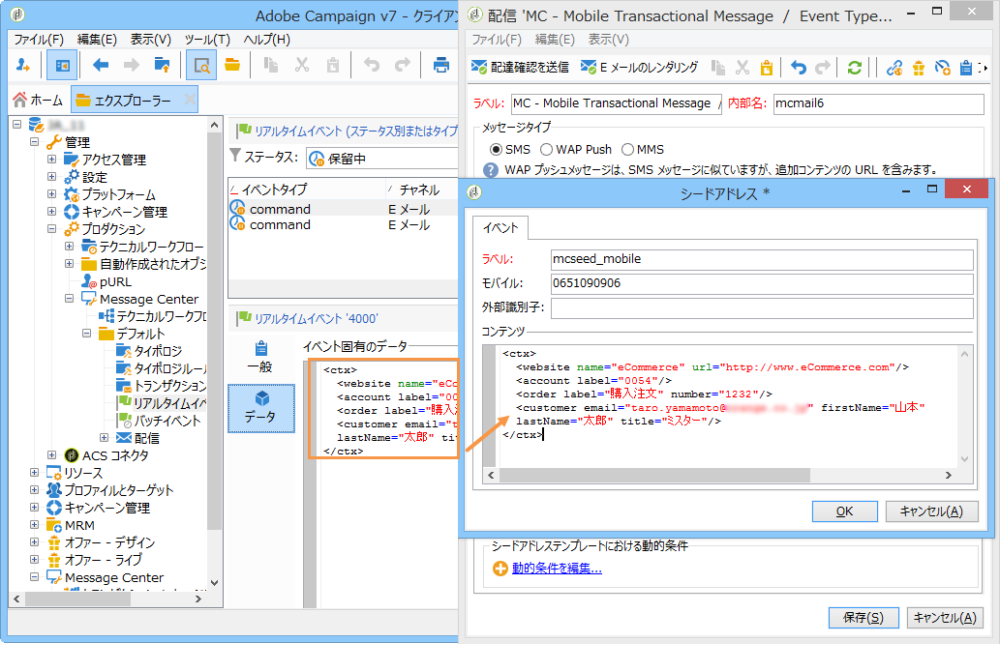
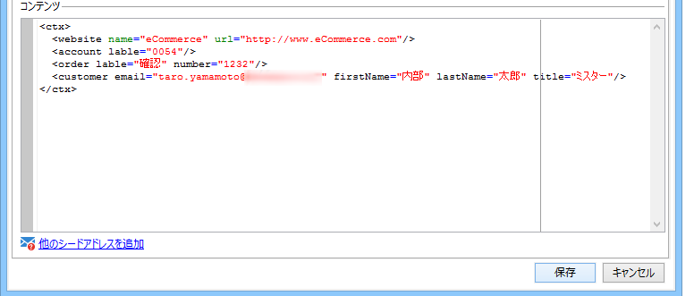

# トランザクションメッセージテンプレートのテスト {#testing-message-templates}

[ メッセージテンプレート ](https://experienceleague.adobe.com/en/docs/campaign/campaign-v8/send/real-time/transactional-template){target="_blank"} （Campaign v8 ドキュメント）の準備が整ったら、次の手順に従ってプレビューとテストを行います。

Campaign v7 から v8 への移行の一環として、Campaign Classic のドキュメントセットを効率化および再編成しました。 共通機能は、Campaign v8 ドキュメントセットでのみ使用できるようになりました。 シードアドレスの追加方法、トランザクションメッセージのプレビュー、プルーフの送信方法については、[Campaign v8 ドキュメント ](https://experienceleague.adobe.com/en/docs/campaign/campaign-v8/send/real-time/transactional-template#test-message-template){target=_blank}を参照してください。

{target=_blank}

## パーソナライゼーションデータ {#personalization-data}

メッセージテンプレート内のデータを使い、トランザクションメッセージのパーソナライゼーションをテストできます。 この機能は、プレビューを生成したり、配達確認を送信するために使用されます。 さまざまなインターネットアクセスプロバイダーに向けたメッセージのレンダリングを表示することもできます。 詳しくは、[受信ボックスのレンダリング](../../delivery/using/inbox-rendering.md)を参照してください。

このデータの目的は、最終的に配信する前にメッセージをテストすることです。 このメッセージは、処理される実際のデータと同一のものではありません。 ただし以下に示すように、XML 構造は実行インスタンスに保存されているイベントの構造と同一です。

この情報を使用すると、パーソナライゼーションタグを使用してメッセージコンテンツをパーソナライズできます（詳しくは、[ メッセージコンテンツの作成](https://experienceleague.adobe.com/en/docs/campaign/campaign-v8/send/real-time/transactional-template#create-message-content){target="_blank"} （Campaign v8 ドキュメント）を参照）。

1. トランザクションメッセージテンプレートを選択します。

1. テンプレートで、「**[!UICONTROL シードアドレス]**」タブをクリックします。

1. イベントコンテンツに、XML フォーマットでテスト情報を入力します。

   

1. 「**[!UICONTROL 保存]**」をクリックします。
